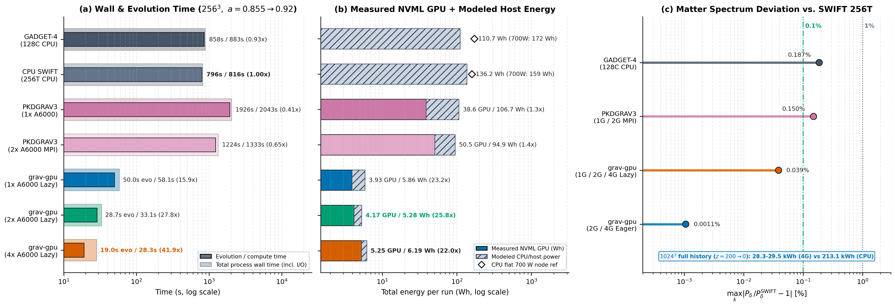

# `gravityCU`: Multi-GPU VRAM-Resident CUDA TreePM + Full-GPU FoF Engine

[](LICENSE) [](ROADMAP.md)

`gravityCU` is a multi-GPU CUDA TreePM cosmological gravity, lightcone, and Full-GPU Friends-of-Friends (FoF / Catalog / Spherical Overdensity) solver designed to evolve from $64^3$ smoke tests up to **$1024^3$ (`1,073,741,824`)** particles **100% resident inside GPU VRAM** (`4× NVIDIA RTX A6000`, `4 × 48 GiB`) without host-device swapping.

---

## Architecture Highlights (Priorities 1–5)

1. **Lazy Tree & Async Device Pipeline**: `GRAV_LAZY_TREE=1` refits persistent octree nodes across active sub-steps (`256^3`: tree time `9.96 s → 1.58 s`), paired with asynchronous host lightcone writes and CUB migrant compaction.
2. **Split-Force Kernel Decomposition (`GRAV_SPLIT_FORCE=1`)**: Separates tree traversal, M2P tensor accumulation, grouped M2L, and warp-tiled P2P into distinct low-register, zero-spill kernels (`0` stack frame, `0` spill).
3. **Pure-CUDA Distributed PM (`GRAV_PM_DIST=1`)**: Multi-GPU distributed FFT long-range Poisson solver (`cudaMalloc` / `can_peer` P2P + pinned bounce staging, zero NCCL dependency).
4. **3D `12×12×12` Top-Cell Domain Decomposition (`GRAV_DOMAIN_MODE=auto`)**: Hilbert (`3d_hilbert`, default when `GRAV_NUM_GPUS > 1`) and ORB (`3d_orb`) topological partitioning with NVLink owner remapping, interior-first slot layout, full-duplex chunked ghost exchange, dynamic rebalancing, and compute/communication overlap (`256^3`, `4× RTX A6000`: **`17.525 s`** total / **`15.729 s`** compute+PM without export I/O, **`2.99×`** vs. `1× GPU` `52.443 s`).
5. **Full-GPU FoF / Catalog / SO & Multi-GPU FoF (`src/grav_cuda_fof.cu`)**:
   - Single-GPU zero-upload `whole_fof_device` and multi-GPU arbitrary-3D-domain `whole_fof_multigpu` (called directly by the 3D engine on resident `d_x` buffers).
   - Full-GPU `whole_fof_slabbed` cross-slab GPU Union-Find merge & CUB relabeling (`0` ID mismatches out of `16.78M` particles across `S=4/8` and `G=1/2/4` 3D decompositions).
   - Full-GPU `compute_fof_catalog` (**`12.48×`** vs. CPU, `max_rel <= 1.16e-13`) and GPU segmented-sort `compute_fof_so` (`M200c/R200c`, `M200m/R200m`, **`15.33×`** uniform / **`5.37×`** non-uniform vs. 8-thread OpenMP CPU, `max_rel <= 3.67e-15`), exposed through an unchanged C ABI (`ctypes`-compatible with [scripts/to-hdf5-from-source.py](scripts/to-hdf5-from-source.py)).

### Verified $1024^3$ Scientific Fidelity (`4× RTX A6000` vs. 256-Core CPU SWIFT)

- **Late-time ($z = 0.063 \to 0$)**: `4,388.62 s` (`73m 09s`) on dual-NVLink `4× RTX A6000` — **`2.40×`** vs. `1× A6000` (`10,540.44 s`) and **`7.26×`** vs. 256-core CPU (`31,878.77 s`).
- **Mid-redshift ($z = 2.033 \to 1.758$)**: `3,510.98 s` (`58m 31s` idle node) — **`9.27×`** vs. 256-core CPU (`9.64×` incl. dump step).
- **Matter Power Spectrum $P_\delta(k)$**: **`0.00453%`** max deviation at $z=0$ and **`0.01019%`** at $z=1.758$.
- **Full-History Projection ($z = 200 \to 0$)**: **`34.6–35.8 h`** pure evolution (`8.50–8.80×` speedup) and **`~86%`** whole-node energy reduction (`28.3–29.2 kWh` vs. `213.1 kWh`).

---

## Speed & Accuracy vs. CPU SWIFT

| Benchmark / Subsystem | CPU Reference | Optimized GPU (Opt1–5) | Speedup | Accuracy vs. CPU / Reference |
| --- | --- | --- | --- | --- |
| $256^3$ Evolution ($a=0.855\to0.92$, 320 steps) | `796.36 s` (`256T` CPU SWIFT) | `17.53 s` (`4× A6000` 3D Hilbert) | **`45.4×`** (`50.6×` no-IO) | $P_\delta(k)$ max `0.0011%` (eager) / `0.0387%` (lazy), $\min r > 0.99999993$ |
| $1024^3$ Evolution ($z=2.03\to1.76$, 910 steps) | `32,538 s` (`256c` CHPC CPU) | `3,511 s` (`4× A6000` NVLink) | **`9.27×`** | $P_\delta(k)$ max `0.01019%`, $P_\theta(k)$ max `0.01112%` |
| $1024^3$ Evolution ($z=0.06\to0$, 513 steps) | `31,879 s` (`256c` CHPC CPU) | `4,389 s` (`4× A6000` NVLink) | **`7.26×`** | $P_\delta(k)$ max `0.00453%`, aligned $P_\theta(k)$ max `0.0405%` |
| $1024^3$ Full Cosmic History ($z=200\to0$) | `304.48 h` / `213.1 kWh` | `34.6–35.8 h` / `28.3–29.2 kWh` | **`8.50–8.80×`** | Energy reduced by **`~86%`** |
| FoF Catalog / SO ($256^3$, $15{,}206$ halos) | `0.835 s` Cat / `1.908 s` SO (`8T`) | `0.0669 s` Cat / `0.1245 s` SO | **`12.48×`** / **`15.33×`** | Catalog `<= 1.16e-13`, SO `<= 3.67e-15`, FoF `0` mismatches |


---

### Cross-Code Runtime, Energy Cost & Accuracy ($256^3$, $a = 0.855 \to 0.92$)

All codes below were benchmarked on the same `phy-gpus` node `a9` (`2× AMD EPYC 9754` 256 cores, `5× NVIDIA RTX A6000`) from the exact same `16,777,216`-particle `L = 25 Mpc/h` snapshot with matched opening angle ($\theta = 0.70$), comoving softening ($\epsilon = 0.001953125\ \text{Mpc}/h$), and timestep factor ($\eta_G = 0.025$ / PKDGRAV3 `dEta = 0.2236068`). GPU power is directly measured via `200 ms` `nvidia-smi` NVML polling; because `a9` lacks unprivileged RAPL `powercap`, host/CPU energy is reported transparently as modeled whole-node power (`+120 W` base host for GPU runs; utilization-scaled `120–800 W` and flat `700 W` reference for dual-socket EPYC CPU runs). Full telemetry is saved in [reports/code-energy-comparison.json](reports/code-energy-comparison.json).

| Code & Configuration | Wall / Evo Time | Throughput (`M/s`) | Measured GPU (Wh) | Whole-Node (Wh) | `J / M-step` (GPU / Node) | Max $P_\delta(k)$ & HMF |
| --- | --- | --- | --- | --- | --- | --- |
| **PKDGRAV3 3.5.1** (`1× A6000`, `-np 1 -sz 16`) | `2043.2 s` / `1926.3 s` | `0.252` (`0.252/GPU`) | `38.57` (`67.9 W`) | `106.68` | `285.9` / `790.8` | `0.150%` (`91/92`, `17/17`) |
| **PKDGRAV3 3.5.1** (`2× A6000 MPI`, `-np 2 -sz 16`) | `1333.2 s` / `1223.6 s` | `0.397` (`0.198/GPU`) | `50.45` (`136.2 W`) | `94.89` | `374.0` / `703.4` | `0.150%` (`91/92`, `17/17`) |
| **GADGET-4** (`128` EPYC cores MPI TreePM) | `883.2 s` / `857.7 s` | `1.206` | — | `110.70` (`700W`: `171.7`) | — / `385.3` (`597.8`) | `0.187%` (`92/92`, `17/17`) |
| **CPU SWIFT** (`256T` EPYC FMM+PM baseline) | `816.0 s` / `796.4 s` | `1.184` | — | `136.16` (`700W`: `158.7`) | — / `519.9` (`605.9`) | Reference (`92`, `17`) |
| **`gravityCU` `1× A6000`** (3D Hilbert Lazy) | `58.09 s` / `50.03 s` | `18.84` (`18.84/GPU`) | **`3.93`** (`241.3 W`) | `5.86` (`23.2×`) | **`15.01`** / `22.40` | `0.0387%` (`92/92`, `17/17`) |
| **`gravityCU` `2× A6000`** (3D Hilbert Lazy) | `33.11 s` / `28.66 s` | `32.88` (`16.44/GPU`) | `4.17` (`448.1 W`) | **`5.27`** (**`25.8×`**) | `15.93` / **`20.15`** | `0.0387%` (`92/92`, `17/17`) |
| **`gravityCU` `4× A6000`** (3D Hilbert Eager) | `30.21 s` / `21.07 s` | `44.74` (`11.19/GPU`) | `5.38` (`635.2 W`) | `6.39` (`21.3×`) | `20.54` / `24.39` | **`0.00106%`** (`92/92`, `17/17`) |
| **`gravityCU` `4× A6000`** (3D Hilbert Lazy) | **`28.26 s` / `18.99 s`** | **`49.62`** (`12.41/GPU`) | `5.25` (`662.7 W`) | `6.19` (`22.0–25.6×`) | `20.05` / `23.64` | `0.0387%` (`92/92`, `17/17`) |

> **Why PKDGRAV3 spends more wall time than `gravityCU` at $256^3$**: PKDGRAV3 offloads FMM+Ewald gravity tiles to GPUs while rebuilding domain decompositions (`67×`, `425.95 s` on `1G` / `278.91 s` on `2G-MPI`) and CPU trees (`245×`, `522.19 s` / `145.87 s`) on host threads across `244` adaptive substeps (`3.3–5.6%` mean GPU utilization). Keeping all `16.78M` particles GPU-resident with TreePM + lazy Hilbert octree refits (`42.7–73.6%` GPU utilization) yields **`29×` faster wall time** and **`18–26×` lower whole-node energy**. On $1024^3$ full-history ($z=200\to0$), live `4× A6000` power measures `657.1–735.9 W`, reducing full-run node energy from `213.1 kWh` to `28.3–29.5 kWh` (`-86%`).



To regenerate all CPU-vs-GPU and cross-code comparison figures from `reports/`:

```bash
python3 scripts/make_opt_comparison_figures.py
python3 scripts/make_code_energy_figure.py
python3 scripts/make_figures.py
```

---

## Quick Start

### Prerequisites

- **CUDA Toolkit >= 12.x** (`nvcc` + `libcufft`), `g++` (C++17 + OpenMP), `make`, and Python 3 with `numpy` (+ `h5py` for HDF5 conversion).
- **For building the full gravity & PM targets (`make engine pm`)**: a configured upstream GPU SWIFT source/build directory `KERNEL_BUILD_DIR` containing `config.h` and `src/{runner_gpu.h,runner_gpu.c,gpu_gravity_offload.cu,gpu_gravity_functions.cuh,kernel_gravity.h,kernel_long_gravity.h,gravity_derivatives.h,multipole.h}` (upstream GPLv3 headers are intentionally not vendored in this MIT repository).
- **Standalone CUDA FoF / C99 CIC / 3D Domain targets (`make fof cic test-domain3d test-fof`) require zero upstream SWIFT headers.**

### Option A: Zero-Dependency Standalone Build & FoF GPU Smoke Test

```bash
# 1. Build standalone FoF shared lib & C99 CIC helper + run CPU 3D-domain unit test
make standalone test-domain3d

# 2. Run synthetic 200K-particle GPU FoF + Catalog + SO ctypes verification
make test-fof
```

Expected output: `DOMAIN3D_SMOKE_PASSED` and `FOF_SMOKE_PASSED`.

### Option B: Full Gravity Engine Build & Synthetic $64^3$ Multi-GPU Smoke Run

```bash
# Override CUDA_ARCH (default sm_86), CUDA_HOME (auto-detected), CXX (default g++) if needed
make engine KERNEL_BUILD_DIR=/path/to/swiftsim CUDA_ARCH=sm_86 CXX=g++
make smoke  KERNEL_BUILD_DIR=/path/to/swiftsim CUDA_ARCH=sm_86 CXX=g++
```

This generates `build/smoke_64.bin` (`64^3` clustered periodic box), evolves `a = 0.85 -> 0.92` on all visible GPUs using `3d_hilbert` (or `1d_slab` on 1 GPU) with inline multi-GPU FoF, and runs `compute_fof_catalog` + `compute_fof_so` via `build/grav_cuda_fof.so`, printing `ALL_SMOKE_TESTS_PASSED`.

### Option C: SWIFT, `monofonIC`, or `MUSIC` HDF5 IC Workflow

```bash
# 1. Convert SWIFT / monofonIC / MUSIC / Gadget HDF5 (single or multi-shard) into dense binary
#    Auto-converts kpc/h & Mpc/h -> Mpc, Gadget u=v/sqrt(a) -> v_pec, MassTable fallback, Zoom-in PartTypes
python3 scripts/prepare_input.py input_snap.hdf5 input.bin --cosmo-env input.cosmo.env

# 2. Run multi-GPU VRAM-resident TreePM + inline FoF to final scale factor a_end=1.0
source input.cosmo.env
GRAV_NUM_GPUS=4 GRAV_DOMAIN_MODE=auto GRAV_DYNAMIC_PM=1 GRAV_PM_DIST=1 \
GRAV_SPLIT_FORCE=1 GRAV_LAZY_TREE=1 GRAV_P2P_MODE=nvlink \
GRAV_RUN_FOF=1 GRAV_FOF_LINK_RATIO=0.2 GRAV_FOF_MIN_SIZE=32 \
  ./build/multi_gpu_slab input.bin evolved.bin 1.0

# 3. Export SWIFT HDF5 snapshot + Full-GPU FOFGroups (CentresOfMass, M200c/R200c, M200m/R200m)
python3 scripts/to-hdf5-from-source.py input_snap.hdf5 evolved.bin output_snap.hdf5 \
  --fof-bin evolved.bin.fof.bin --fof-lib build/grav_cuda_fof.so
```

Ready-to-use `monofonIC` (2LPT/3LPT) and `MUSIC` (Zoom-in multi-mass) templates live in [configs/ic/](configs/ic/README.md), verified via `make test-ic`. Note: `prepare_input.py` works for any $N$ (`64^3`–`1024^3`); [scripts/prepare_1024_input.py](scripts/prepare_1024_input.py) is kept specifically for reproducing the original $1024^3$ scripts.

---

## Runtime Environment Variables (`multi_gpu_slab`)

| Variable | Default | Description & Notes |
| --- | --- | --- |
| `GRAV_NUM_GPUS` | all visible GPUs | Number of GPUs (`1..12`, up to visible CUDA devices) |
| `GRAV_DOMAIN_MODE` | `auto` | `auto` selects `3d_hilbert` when `G > 1` (`1d_slab` when `G = 1`); also accepts `1d_slab`, `3d_hilbert`, `3d_orb` |
| `GRAV_P2P_MODE` | `nvlink` | `nvlink` (recommended on EPYC multi-root PCIe to avoid cross-root `NODE` P2P stalls), `all`, or `off` |
| `GRAV_DYNAMIC_PM` | unset (`0`) | Set `GRAV_DYNAMIC_PM=1` for periodic cosmological PM step scaling (`16` PM intervals) |
| `GRAV_PM_DIST` | `1` (when `G > 1`) | Distributed multi-GPU FFT PM solver (`0` disables) |
| `GRAV_PM_GRID` | `128` | PM FFT grid size (power of 2 in `32..1024`) |
| `GRAV_PM_ORDER` | `2` (`cic`) | PM mass-assignment / interpolation order: `2` (`cic`), `3` (`tsc`), or `4` (`pcs`) with matched $\text{sinc}^{-2p}$ deconvolution |
| `GRAV_PM_INTERLACE` | `0` | Set `1` for symmetric half-cell interlaced PM (cancels odd aliases while preserving zero self-force & momentum conservation) |
| `GRAV_PM_GRAD` | `fd4` | PM force gradient operator: `fd4` (4th-order finite difference, SWIFT default) or `ik` (exact $-i\mathbf{k}$ spectral gradient) |
| `GRAV_PM_ASMTH` | `1.25` | TreePM split scale ratio $r_s/\Delta x$ (default `1.25` matches SWIFT; also scales short-range cutoff $4.5\,r_s$) |
| `GRAV_SPLIT_FORCE` | `1` (periodic) | Split traversal / M2P / M2L / P2P kernels (required for 3D domain modes) |
| `GRAV_LAZY_TREE` | `1` (periodic) | Lazy node refit across active sub-steps |
| `GRAV_REBALANCE_INTERVAL` | `8` | Rebalance cadence in steps for 3D domains (`0` disables live rebalancing) |
| `GRAV_REBALANCE_MIN_GAIN` | `0.02` | Minimum predicted imbalance improvement to commit rebalance |
| `GRAV_RUN_FOF` | `0` | Set `1` to compute inline FoF (`*.fof.bin`) at snapshot/final outputs via `whole_fof_multigpu` |
| `GRAV_ENERGY_LOG` | `0` | Set `1` to log per-PM-step kinetic/potential energy ($T, U, E$), momentum ($\mathbf{P}, \mathbf{L}$), and Layzer–Irvine checks |
| `GRAV_FOF_LINK_RATIO` / `_MIN_SIZE` | `0.2` / `32` | Linking length ratio $b$ (in mean interparticle spacing) and minimum halo size |
| `GRAV_G` | `43.0092` | Gravitational constant in internal units (`Mpc`, `10^10 Msun`, `km/s`) |
| `GRAV_COSMO_H0` / `OMEGA_M` / `OMEGA_DE` | `67.36` / `0.3153` / `0.6847` | Cosmological parameters |

---

## Slurm Templates

Ready-to-customize Slurm scripts live in [slurm/](slurm/):

- [slurm/quickstart-smoke.sbatch](slurm/quickstart-smoke.sbatch) — 1-minute `make engine && make smoke` sanity check
- [slurm/mgpu-256-test.sbatch](slurm/mgpu-256-test.sbatch) — $256^3$ multi-GPU scaling & build benchmark
- [slurm/mgpu-1024-0045-e2e.sbatch](slurm/mgpu-1024-0045-e2e.sbatch) & [slurm/mgpu-1024-0056-e2e.sbatch](slurm/mgpu-1024-0056-e2e.sbatch) — $1024^3$ mid-$z$ and $z=0$ end-to-end validation runs

All templates read `KERNEL_BUILD_DIR`, `DATA_DIR`, `CUDA_HOME`, `CXX_BIN`, and `PYTHON_BIN` from environment variables (with no hardcoded user home paths).

---

## Repository Structure

```text
gravityCU/
├── Makefile                       # Turnkey build & smoke targets (fof, pm, pm-mpi, engine, mpi-engine, smoke)
├── ROADMAP.md                     # Precision (P1-P3), Physics Breadth (B1-B4) & Deferred Exascale schedule
├── src/
│   ├── multi_gpu_slab.cu          # Multi-GPU TreePM driver (1d_slab + 3D domain + optional MPI modes)
│   ├── slab_resident.cu           # Single-GPU 12-slab baseline driver
│   ├── grouped_force.cuh          # Morton tile grouped M2L/P2P force evaluation helpers
│   ├── grav_domain_3d.h           # 12×12×12 Hilbert / ORB partitioner & NVLink owner remapping
│   ├── grav_domain_3d_engine.cuh  # Single-node 3D domain execution engine & overlap pipeline
│   ├── grav_domain_3d_mpi.cuh     # Multi-node MPI 3D domain execution engine (compiled cleanly)
│   ├── grav_mpi_comm.h            # MPI wrapper utilities & node topology helpers
│   ├── grav_cuda_pm.cu/h          # Single-GPU cuFFT particle-mesh solver
│   ├── grav_cuda_pm_dist.cu/h     # Pure-CUDA single-node distributed FFT PM solver
│   ├── grav_cuda_pm_mpi.cu/h      # Multi-node MPI 1D-slab cuFFT + Alltoallv PM solver
│   ├── grav_cuda_fof.cu/h         # Full-GPU FoF, slab merge, multi-GPU FoF, Catalog & SO solvers
│   ├── make-evolution.py          # Instrumented GPU octree & M2P/M2L code generator
│   └── cic_deposit.c              # Deterministic C99 CIC grid deposition helper
├── tree/                          # Project-owned octree builder sources (used by make-evolution.py)
├── m2p/                           # Project-owned M2P kernel port helpers (used by make-port.py)
├── scripts/
│   ├── prepare_input.py           # General SWIFT HDF5 -> dense binary IC/snapshot converter
│   ├── prepare_1024_input.py      # Legacy 1024^3 converter for archival scripts
│   ├── make_smoke_ic.py           # Synthetic clustered periodic DM IC generator (numpy-only)
│   ├── make_plummer_ic.py         # Equilibrium isolated Plummer sphere IC generator (energy/virial gate)
│   ├── zeldovich_benchmark.py     # 1D EdS Zel'dovich plane-wave generator & analytical verifier
│   ├── smoke_fof.py               # Standalone ctypes FoF + Catalog + SO parity smoke test
│   ├── verify_smoke_e2e.py        # End-to-end smoke output & SO verifier
│   ├── test_domain3d_smoke.cpp    # Standalone C++17 3D domain decomposition & MultiNodeCommStats unit test
│   ├── test_mpi_pm.cu             # Multi-node MPI PM FFT parity & latency benchmark
│   ├── to-hdf5-from-source.py     # Dense .bin + .fof.bin -> SWIFT HDF5 + FOFGroups exporter
│   ├── eval_1024_snapshot.py      # P(k), P_theta(k), halo mass function & kick-alignment analyzer
│   ├── model_1024_full_history.py # Full-history z=200->0 scaling & energy model
│   ├── make_figures.py            # Manuscript figure generator (fig1-fig4)
│   ├── make_opt_comparison_figures.py # CPU-vs-GPU speed & accuracy comparison plots (fig5-fig6)
│   └── make_code_energy_figure.py # Cross-code runtime, NVML energy & accuracy plot (fig7)
├── slurm/                         # Parameterized Slurm job templates (incl. mpi-multinode-test.sbatch)
├── reports/                       # Verified opt12..opt5, code-energy, analytical gates & mpi-multinode-bench JSONs
├── paper/                         # Physical Review D (revtex4-2) manuscript, BibTeX & figures
└── index.html / en.html           # Interactive bilingual benchmark & accuracy showcase pages
```

---

## Roadmap

For the full 18-week schedule, acceptance gates, and compute/storage tiers, see **[ROADMAP.md](ROADMAP.md)**.

### Completed (DMO Gravity + FoF Pipeline)
- [x] Lazy octree refit, async lightcone host writes, and CUB migrant compaction
- [x] Split traversal / M2P / M2L / P2P zero-spill kernels (`GRAV_SPLIT_FORCE=1`)
- [x] Pure-CUDA distributed multi-GPU FFT PM solver (`GRAV_PM_DIST=1`)
- [x] 3D `12×12×12` Hilbert/ORB domain decomposition, dynamic rebalancing, and compute/communication overlap
- [x] Full-GPU FoF, cross-slab GPU merge, multi-GPU 3D inline FoF, Catalog, and SO (`M200c/R200c`, `M200m/R200m`)
- [x] Pre-MPI & analytical physics gates ([reports/pre-mpi-physics-gate.json](reports/pre-mpi-physics-gate.json), [reports/analytical-physics-gates.json](reports/analytical-physics-gates.json)): 1D EdS Zel'dovich collapse ($64^3$, $a=0.02\to0.50$: $\Delta x_{\rm RMS}/L = 4.41\times 10^{-4}$, $\Delta v_{\rm RMS}/v_{\rm pk} = 0.592\%$), exact periodic Ewald $\theta$-convergence (short median $8.48\times 10^{-3} \to 1.14\times 10^{-4}$ across $\theta \in [0.9, 0.3]$; total median $1.98\times 10^{-3}$ at $\theta=0.7$), Layzer–Irvine energy (`3.07e-4`) & momentum (`3.72e-5`) across $z=200\to0$ ($526.6\text{ s}$, $9{,}257$ steps, $0.123\%$ $P_\delta(k)$, $18/18$ massive halos), 32K Plummer virial/energy (`1.15e-5`), and 4-GPU boundary force parity (`1.03e-4` median)

### In Progress (Phase 2 Multi-Node MPI Close-Out — [reports/mpi-multinode-bench.json](reports/mpi-multinode-bench.json))
- [x] **Milestone 2A**: 3D domain MPI topology & contiguous Hilbert `MultiNodeCommStats` (`DOMAIN3D_SMOKE_PASSED`)
- [x] **Milestone 2B (`np=2`)**: MPI 1D-slab cuFFT PM verified on `phy-gpus` (`b4`, RTX 4090, `np=2, side=128, N=64^3`: `max_rel_field=1.012e-14`, `max_rel_pot=3.177e-16`, `pm_comm_ms=90.875`, `MPI_PM_PASSED`)
- [x] **Milestone 2C (Build)**: `test_mpi_pm`, `grav_mpi`, and `multi_gpu_slab` compiled cleanly on `phy-gpus` (`sm_89`, OpenMPI 4.1.6 + CUDA 12.6)
- [ ] **Gates M1/M2/M3**: `1N×4R` / `2N` PM completion, $64^3$ 4-rank/2N parity vs. 1G, and $256^3$ multi-node scaling (`slurm/mpi-multinode-test.sbatch`, pending free GPUs on `phy-gpus`)

### Prioritized Active Tracks (1–4× Lab GPUs, Weeks 2–18)
- [ ] **Track 1 — Numerical Precision (`P1–P3`)**: High-order PM (**TSC/PCS + Interlacing** + $i\mathbf{k}$ spectral gradient, target Ewald total force `< 1e-4`), 5th-order multipoles / FMM `L2P` + FP64 `GRAV_PRECISION_MODE=high` (target `~1–3e-5` & Layzer–Irvine `< 1e-4`), and tidal/symplectic timestep refinement (Plummer drift `< 1e-6`).
- [ ] **Track 2 — Physics Breadth (`B1–B4`)**: **$k$-space linear-response massive neutrinos** (`< 0.5%` match to CLASS/CAMB & GADGET-4/SWIFT), **GPU Monte Carlo SIDM** on resident octree leaves + $f(R)$ multigrid modified gravity, **multi-mass zoom-in** halos (`4096^3`–`8192^3` equivalent), and **Full-GPU Hydrodynamics (SPH/MFM + cooling)** validated on Sod, Sedov–Taylor, Kelvin–Helmholtz, and Santa Barbara cluster benchmarks.

### Deferred Track (Exascale / 10k-GPU Infrastructure)
- [ ] **Track 3 — Exascale Readiness (`S1–S4`, deferred)**: Dynamic $N_{\rm top} \propto G^{1/3}$ / ORB tree cuts (replacing static `12^3`), `cuFFTMp` / `heFFTe` 2D pencil FFT + `MPI_Alltoallv_c`, sparse neighborhood graph + LET pruning, `uint64_t` particle IDs, and parallel HDF5 / ADIOS2 async checkpointing.

---

## Citation & Authorship

Author: **Haina Huang** (Department of Physics, The Chinese University of Hong Kong).  
See [paper/main.tex](paper/main.tex) and [reports/MULTI-GPU-AND-VALIDATION-REPORT.md](reports/MULTI-GPU-AND-VALIDATION-REPORT.md) for full derivations, kernel specifications, and benchmark provenance.
