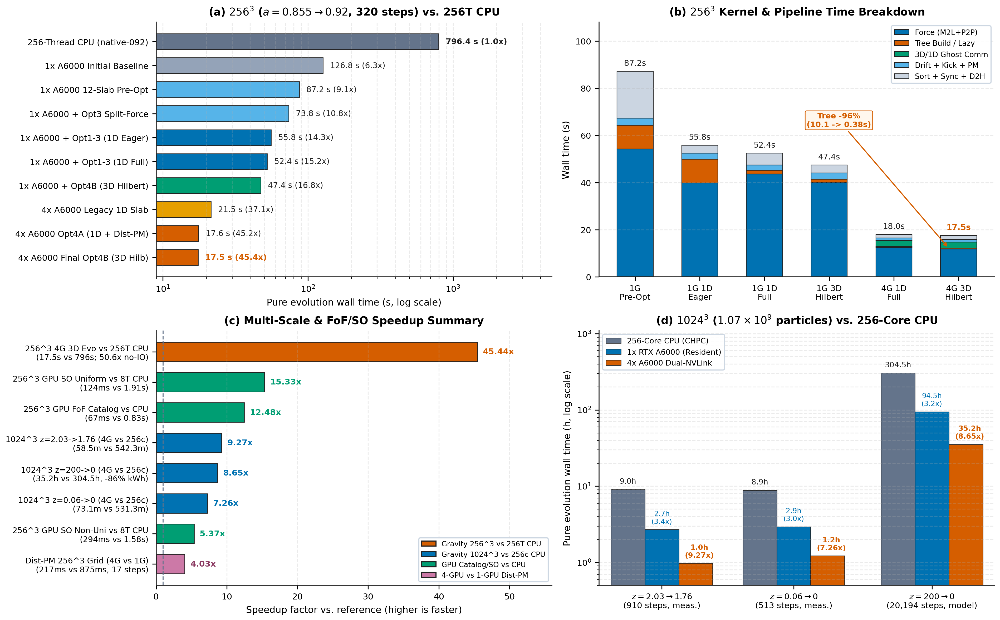
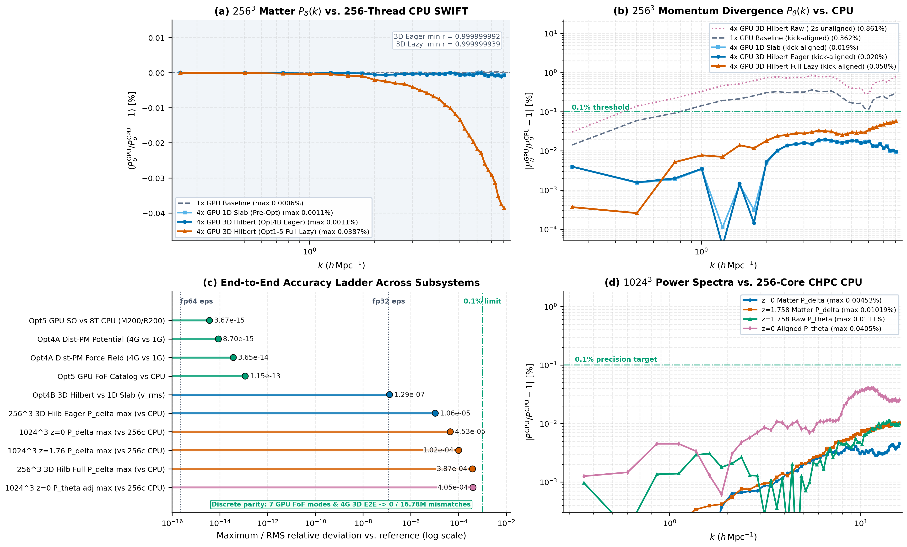

# `swift-treepm-gpu`: Multi-GPU VRAM-Resident CUDA TreePM + Full-GPU FoF Engine

[](LICENSE)

`swift-treepm-gpu` is a multi-GPU CUDA TreePM cosmological gravity, lightcone, and Full-GPU Friends-of-Friends (FoF / Catalog / Spherical Overdensity) solver designed to evolve from $64^3$ smoke tests up to **$1024^3$ (`1,073,741,824`)** particles **100% resident inside GPU VRAM** (`4× NVIDIA RTX A6000`, `4 × 48 GiB`) without host-device swapping.

---

## Architecture Highlights (Priorities 1–5)

1. **Lazy Tree & Async Device Pipeline**: `SWIFT_LAZY_TREE=1` refits persistent octree nodes across active sub-steps (`256^3`: tree time `9.96 s → 1.58 s`), paired with asynchronous host lightcone writes and CUB migrant compaction.
2. **Split-Force Kernel Decomposition (`SWIFT_SPLIT_FORCE=1`)**: Separates tree traversal, M2P tensor accumulation, grouped M2L, and warp-tiled P2P into distinct low-register, zero-spill kernels (`0` stack frame, `0` spill).
3. **Pure-CUDA Distributed PM (`SWIFT_PM_DIST=1`)**: Multi-GPU distributed FFT long-range Poisson solver (`cudaMalloc` / `can_peer` P2P + pinned bounce staging, zero NCCL dependency).
4. **3D `12×12×12` Top-Cell Domain Decomposition (`SWIFT_DOMAIN_MODE=auto`)**: Hilbert (`3d_hilbert`, default when `SWIFT_NUM_GPUS > 1`) and ORB (`3d_orb`) topological partitioning with NVLink owner remapping, interior-first slot layout, full-duplex chunked ghost exchange, dynamic rebalancing, and compute/communication overlap (`256^3`, `4× RTX A6000`: **`17.525 s`** total / **`15.729 s`** compute+PM without export I/O, **`2.99×`** vs. `1× GPU` `52.443 s`).
5. **Full-GPU FoF / Catalog / SO & Multi-GPU FoF (`src/swift_cuda_fof.cu`)**:
   - Single-GPU zero-upload `whole_fof_device_swift` and multi-GPU arbitrary-3D-domain `whole_fof_multigpu_swift` (called directly by the 3D engine on resident `d_x` buffers).
   - Full-GPU `whole_fof_slabbed_swift` cross-slab GPU Union-Find merge & CUB relabeling (`0` ID mismatches out of `16.78M` particles across `S=4/8` and `G=1/2/4` 3D decompositions).
   - Full-GPU `compute_fof_catalog` (**`12.48×`** vs. CPU, `max_rel <= 1.16e-13`) and GPU segmented-sort `compute_fof_so` (`M200c/R200c`, `M200m/R200m`, **`15.33×`** uniform / **`5.37×`** non-uniform vs. 8-thread OpenMP CPU, `max_rel <= 3.67e-15`), exposed through an unchanged C ABI (`ctypes`-compatible with [scripts/to-hdf5-from-source.py](scripts/to-hdf5-from-source.py)).

### Verified $1024^3$ Scientific Fidelity (`4× RTX A6000` vs. 256-Core CPU SWIFT)

- **Late-time ($z = 0.063 \to 0$)**: `4,388.62 s` (`73m 09s`) on dual-NVLink `4× RTX A6000` — **`2.40×`** vs. `1× A6000` (`10,540.44 s`) and **`7.26×`** vs. 256-core CPU (`31,878.77 s`).
- **Mid-redshift ($z = 2.033 \to 1.758$)**: `3,510.98 s` (`58m 31s` idle node) — **`9.27×`** vs. 256-core CPU (`9.64×` incl. dump step).
- **Matter Power Spectrum $P_\delta(k)$**: **`0.00453%`** max deviation at $z=0$ and **`0.01019%`** at $z=1.758$.
- **Full-History Projection ($z = 200 \to 0$)**: **`34.6–35.8 h`** pure evolution (`8.50–8.80×` speedup) and **`~86%`** whole-node energy reduction (`28.3–29.2 kWh` vs. `213.1 kWh`).

---

## Speed & Accuracy vs. CPU SWIFT

| Benchmark / Subsystem | CPU Reference | Optimized GPU (Opt1–5) | Speedup | Accuracy vs. CPU / Reference |
| --- | --- | --- | --- | --- |
| $256^3$ Evolution ($a=0.855\to0.92$, 320 steps) | `796.36 s` (`256T` CPU SWIFT) | `17.53 s` (`4× A6000` 3D Hilbert) | **`45.4×`** (`50.6×` no-IO) | $P_\delta(k)$ max `0.0011%` (eager) / `0.0387%` (lazy), $\min r > 0.99999993$ |
| $1024^3$ Evolution ($z=2.03\to1.76$, 910 steps) | `32,538 s` (`256c` CHPC CPU) | `3,511 s` (`4× A6000` NVLink) | **`9.27×`** | $P_\delta(k)$ max `0.01019%`, $P_\theta(k)$ max `0.01112%` |
| $1024^3$ Evolution ($z=0.06\to0$, 513 steps) | `31,879 s` (`256c` CHPC CPU) | `4,389 s` (`4× A6000` NVLink) | **`7.26×`** | $P_\delta(k)$ max `0.00453%`, aligned $P_\theta(k)$ max `0.0405%` |
| $1024^3$ Full Cosmic History ($z=200\to0$) | `304.48 h` / `213.1 kWh` | `34.6–35.8 h` / `28.3–29.2 kWh` | **`8.50–8.80×`** | Energy reduced by **`~86%`** |
| FoF Catalog / SO ($256^3$, $15{,}206$ halos) | `0.835 s` Cat / `1.908 s` SO (`8T`) | `0.0669 s` Cat / `0.1245 s` SO | **`12.48×`** / **`15.33×`** | Catalog `<= 1.16e-13`, SO `<= 3.67e-15`, FoF `0` mismatches |





To regenerate all CPU-vs-GPU comparison figures and manuscript figures from `reports/`:

```bash
python3 scripts/make_opt_comparison_figures.py
python3 scripts/make_figures.py
```

---

## Quick Start

### Prerequisites

- **CUDA Toolkit >= 12.x** (`nvcc` + `libcufft`), `g++` (C++17 + OpenMP), `make`, and Python 3 with `numpy` (+ `h5py` for HDF5 conversion).
- **For building the full gravity & PM targets (`make engine pm`)**: a configured upstream GPU SWIFT source/build directory `SWIFT_BUILD_DIR` containing `config.h` and `src/{runner_gpu.h,runner_gpu.c,gpu_gravity_offload.cu,gpu_gravity_functions.cuh,kernel_gravity.h,kernel_long_gravity.h,gravity_derivatives.h,multipole.h}` (upstream GPLv3 headers are intentionally not vendored in this MIT repository).
- **Standalone CUDA FoF / C99 CIC / 3D Domain targets (`make fof cic test-domain3d test-fof`) require zero upstream SWIFT headers.**

### Option A: Zero-Dependency Standalone Build & FoF GPU Smoke Test

```bash
# 1. Build standalone FoF shared lib & C99 CIC helper + run CPU 3D-domain unit test
make standalone test-domain3d

# 2. Run synthetic 200K-particle GPU FoF + Catalog + SO ctypes verification
make test-fof
```

Expected output: `DOMAIN3D_SMOKE_PASSED` and `FOF_SMOKE_PASSED`.

### Option B: Full Gravity Engine Build & Synthetic $64^3$ Multi-GPU Smoke Run

```bash
# Override CUDA_ARCH (default sm_86), CUDA_HOME (auto-detected), CXX (default g++) if needed
make engine SWIFT_BUILD_DIR=/path/to/swiftsim CUDA_ARCH=sm_86 CXX=g++
make smoke  SWIFT_BUILD_DIR=/path/to/swiftsim CUDA_ARCH=sm_86 CXX=g++
```

This generates `build/smoke_64.bin` (`64^3` clustered periodic box), evolves `a = 0.85 -> 0.92` on all visible GPUs using `3d_hilbert` (or `1d_slab` on 1 GPU) with inline multi-GPU FoF, and runs `compute_fof_catalog` + `compute_fof_so` via `build/swift_cuda_fof.so`, printing `ALL_SMOKE_TESTS_PASSED`.

### Option C: Real SWIFT HDF5 Snapshot Workflow

```bash
# 1. Convert SWIFT PartType1 HDF5 IC/snapshot into dense internal binary
python3 scripts/prepare_swift_input.py input_snap.hdf5 input.bin

# 2. Run multi-GPU VRAM-resident TreePM + inline FoF to final scale factor a_end=1.0
SWIFT_NUM_GPUS=4 SWIFT_DOMAIN_MODE=auto SWIFT_DYNAMIC_PM=1 SWIFT_PM_DIST=1 \
SWIFT_SPLIT_FORCE=1 SWIFT_LAZY_TREE=1 SWIFT_P2P_MODE=nvlink \
SWIFT_RUN_FOF=1 SWIFT_FOF_LINK_RATIO=0.2 SWIFT_FOF_MIN_SIZE=32 \
  ./build/multi_gpu_slab input.bin evolved.bin 1.0

# 3. Export SWIFT HDF5 snapshot + Full-GPU FOFGroups (CentresOfMass, M200c/R200c, M200m/R200m)
python3 scripts/to-hdf5-from-source.py input_snap.hdf5 evolved.bin output_snap.hdf5 \
  --fof-bin evolved.bin.fof.bin --fof-lib build/swift_cuda_fof.so
```

Note: `prepare_swift_input.py` works for any $N$ (`64^3`–`1024^3`); [scripts/prepare_1024_input.py](scripts/prepare_1024_input.py) is kept specifically for reproducing the original $1024^3$ scripts.

---

## Runtime Environment Variables (`multi_gpu_slab`)

| Variable | Default | Description & Notes |
| --- | --- | --- |
| `SWIFT_NUM_GPUS` | all visible GPUs | Number of GPUs (`1..12`, up to visible CUDA devices) |
| `SWIFT_DOMAIN_MODE` | `auto` | `auto` selects `3d_hilbert` when `G > 1` (`1d_slab` when `G = 1`); also accepts `1d_slab`, `3d_hilbert`, `3d_orb` |
| `SWIFT_P2P_MODE` | `nvlink` | `nvlink` (recommended on EPYC multi-root PCIe to avoid cross-root `NODE` P2P stalls), `all`, or `off` |
| `SWIFT_DYNAMIC_PM` | unset (`0`) | Set `SWIFT_DYNAMIC_PM=1` for periodic cosmological PM step scaling (`16` PM intervals) |
| `SWIFT_PM_DIST` | `1` (when `G > 1`) | Distributed multi-GPU FFT PM solver (`0` disables) |
| `SWIFT_PM_GRID` | `128` | PM FFT grid size (power of 2 in `32..1024`) |
| `SWIFT_SPLIT_FORCE` | `1` (periodic) | Split traversal / M2P / M2L / P2P kernels (required for 3D domain modes) |
| `SWIFT_LAZY_TREE` | `1` (periodic) | Lazy node refit across active sub-steps |
| `SWIFT_REBALANCE_INTERVAL` | `8` | Rebalance cadence in steps for 3D domains (`0` disables live rebalancing) |
| `SWIFT_REBALANCE_MIN_GAIN` | `0.02` | Minimum predicted imbalance improvement to commit rebalance |
| `SWIFT_RUN_FOF` | `0` | Set `1` to compute inline FoF (`*.fof.bin`) at snapshot/final outputs via `whole_fof_multigpu_swift` |
| `SWIFT_ENERGY_LOG` | `0` | Set `1` to log per-PM-step kinetic/potential energy ($T, U, E$), momentum ($\mathbf{P}, \mathbf{L}$), and Layzer–Irvine checks |
| `SWIFT_FOF_LINK_RATIO` / `_MIN_SIZE` | `0.2` / `32` | Linking length ratio $b$ (in mean interparticle spacing) and minimum halo size |
| `SWIFT_GRAV_G` | `43.0092` | Gravitational constant in internal units (`Mpc`, `10^10 Msun`, `km/s`) |
| `SWIFT_COSMO_H0` / `OMEGA_M` / `OMEGA_DE` | `67.36` / `0.3153` / `0.6847` | Cosmological parameters |

---

## Slurm Templates

Ready-to-customize Slurm scripts live in [slurm/](slurm/):

- [slurm/quickstart-smoke.sbatch](slurm/quickstart-smoke.sbatch) — 1-minute `make engine && make smoke` sanity check
- [slurm/mgpu-256-test.sbatch](slurm/mgpu-256-test.sbatch) — $256^3$ multi-GPU scaling & build benchmark
- [slurm/mgpu-1024-0045-e2e.sbatch](slurm/mgpu-1024-0045-e2e.sbatch) & [slurm/mgpu-1024-0056-e2e.sbatch](slurm/mgpu-1024-0056-e2e.sbatch) — $1024^3$ mid-$z$ and $z=0$ end-to-end validation runs

All templates read `SWIFT_BUILD_DIR`, `DATA_DIR`, `CUDA_HOME`, `CXX_BIN`, and `PYTHON_BIN` from environment variables (with no hardcoded user home paths).

---

## Repository Structure

```text
swift-treepm-gpu/
├── Makefile                        # Turnkey build & smoke targets (fof, pm, cic, engine, smoke)
├── src/
│   ├── multi_gpu_slab.cu           # Multi-GPU TreePM driver (1d_slab + 3D domain modes)
│   ├── slab_resident.cu            # Single-GPU 12-slab baseline driver
│   ├── grouped_force.cuh           # Morton tile grouped M2L/P2P force evaluation helpers
│   ├── swift_domain_3d.h           # 12×12×12 Hilbert / ORB partitioner & NVLink owner remapping
│   ├── swift_domain_3d_engine.cuh  # Multi-GPU 3D domain execution engine & overlap pipeline
│   ├── swift_cuda_pm.cu/h          # Single-GPU cuFFT particle-mesh solver
│   ├── swift_cuda_pm_dist.cu/h     # Pure-CUDA multi-GPU distributed FFT PM solver
│   ├── swift_cuda_fof.cu/h         # Full-GPU FoF, slab merge, multi-GPU FoF, Catalog & SO solvers
│   ├── make-evolution.py           # Instrumented GPU octree & M2P/M2L code generator
│   └── cic_deposit.c               # Deterministic C99 CIC grid deposition helper
├── tree/                           # Project-owned octree builder sources (used by make-evolution.py)
├── m2p/                            # Project-owned M2P kernel port helpers (used by make-port.py)
├── scripts/
│   ├── prepare_swift_input.py      # General SWIFT HDF5 -> dense binary IC/snapshot converter
│   ├── prepare_1024_input.py       # Legacy 1024^3 converter for archival scripts
│   ├── make_smoke_ic.py            # Synthetic clustered periodic DM IC generator (numpy-only)
│   ├── make_plummer_ic.py          # Equilibrium isolated Plummer sphere IC generator (energy/virial gate)
│   ├── smoke_fof.py                # Standalone ctypes FoF + Catalog + SO parity smoke test
│   ├── verify_smoke_e2e.py         # End-to-end smoke output & SO verifier
│   ├── test_domain3d_smoke.cpp     # Standalone C++17 3D domain decomposition unit test
│   ├── to-hdf5-from-source.py      # Dense .bin + .fof.bin -> SWIFT HDF5 + FOFGroups exporter
│   ├── eval_1024_snapshot.py       # P(k), P_theta(k), halo mass function & kick-alignment analyzer
│   ├── model_1024_full_history.py  # Full-history z=200->0 scaling & energy model
│   ├── make_figures.py             # Manuscript figure generator (fig1-fig4)
│   └── make_opt_comparison_figures.py # CPU-vs-GPU speed & accuracy comparison plots (fig5-fig6)
├── slurm/                          # Parameterized Slurm job templates
├── reports/                        # Verified opt12..opt5 JSON benchmarks, 256^3/1024^3 CPU accuracy CSV/JSONs & native-092.time
├── paper/                          # Physical Review D (revtex4-2) manuscript, BibTeX & figures
└── index.html                      # Interactive benchmark & accuracy showcase page
```

---

## Roadmap

### Completed (DMO Gravity + FoF Pipeline)
- [x] Lazy octree refit, async lightcone host writes, and CUB migrant compaction
- [x] Split traversal / M2P / M2L / P2P zero-spill kernels (`SWIFT_SPLIT_FORCE=1`)
- [x] Pure-CUDA distributed multi-GPU FFT PM solver (`SWIFT_PM_DIST=1`)
- [x] 3D `12×12×12` Hilbert/ORB domain decomposition, dynamic rebalancing, and compute/communication overlap
- [x] Full-GPU FoF, cross-slab GPU merge, multi-GPU 3D inline FoF, Catalog, and SO (`M200c/R200c`, `M200m/R200m`)
- [x] Pre-MPI gravity physics gate ([reports/pre-mpi-physics-gate.json](reports/pre-mpi-physics-gate.json)): Layzer–Irvine energy (`3.07e-4`) & momentum (`3.72e-5`) across $z=200\to0$ ($526.6\text{ s}$, $9{,}257$ steps, $0.123\%$ $P_\delta(k)$, $18/18$ massive halos), 32K Plummer virial/energy (`1.15e-5`), and 4-GPU boundary force parity (`1.03e-4` median)

### Planned Extensions
- [ ] **Multi-Node MPI + GPU-Direct RDMA**: Extend 3D domain decomposition and distributed FFT PM across nodes to scale from $1024^3$ to $2048^3$–$4096^3$.
- [ ] **SPH Hydrodynamics (`PartType0`)**: Port SPHENIX neighbor search, smoothing-length iteration, density loop, and hydro force/thermodynamics kernels to GPU.
- [ ] **Baryonic Subgrid Physics (`PartType4/5`)**: Add radiative cooling, star formation, stellar/SN feedback, and black hole accretion/AGN feedback.
- [ ] **Online Diagnostics & Direct I/O**: Compute $P_\delta(k)$ / $P_\theta(k)$ on-GPU during evolution and support direct C/CUDA HDF5 snapshot writes without `.bin` staging.
- [ ] **Beyond-$\Lambda$CDM Physics**: Support massive neutrino species and modified-gravity force kernels.

---

## Citation & Authorship

Author: **Haina Huang** (Department of Physics, The Chinese University of Hong Kong).  
See [paper/main.tex](paper/main.tex) and [reports/MULTI-GPU-AND-VALIDATION-REPORT.md](reports/MULTI-GPU-AND-VALIDATION-REPORT.md) for full derivations, kernel specifications, and benchmark provenance.
